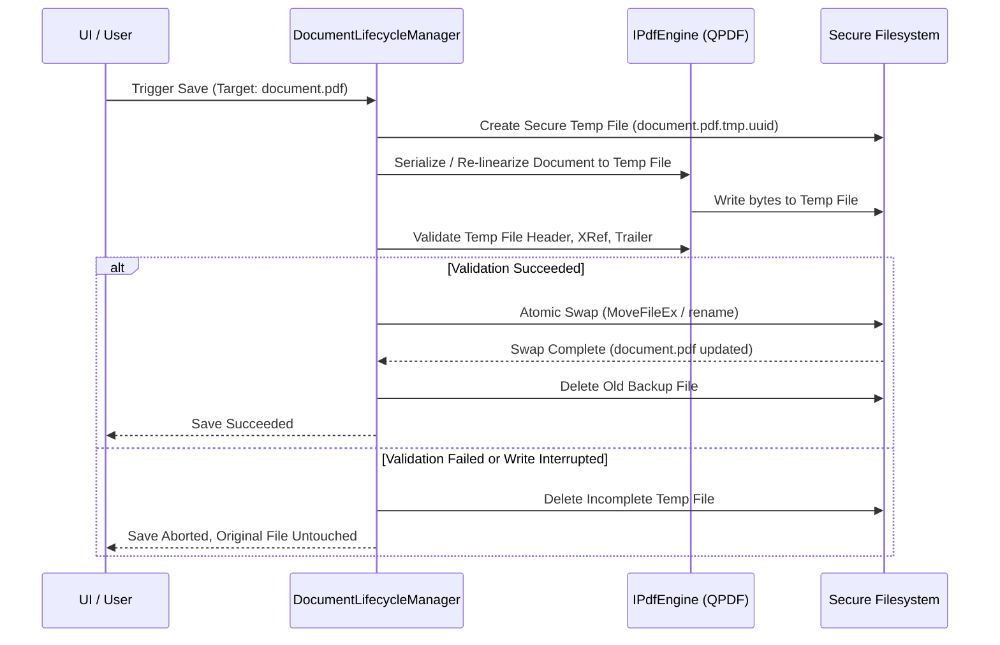

# PDFinity: System Architecture and Modular Design Specification

**Document Version:** 1.0.0  
**Publisher:** StackSync Solutions ([stacksyncsolutions.com](https://www.stacksyncsolutions.com/))  
**Lead Programmer:** Jake Ashley Panlilio ([github.com/jakepanlilio2000](https://github.com/jakepanlilio2000))  
**Primary License:** Mozilla Public License Version 2.0 (MPL-2.0)  
**Status:** Official System Architecture Specification  

---

## 1. Architectural Vision and Core Principles

PDFinity is architected as an offline-first, modular, enterprise-grade desktop PDF productivity suite. The system design strictly adheres to the following principles:

1. **Clean Separation of Concerns:** Strict layer boundaries where UI, domain logic, PDF engine adapters, services, platform adapters, and persistence are strictly decoupled.
2. **Third-Party Engine Isolation:** Third-party PDF engines (PDFium, QPDF) are entirely encapsulated behind an internal `PdfEngineInterface`. Application code and UI never include third-party headers directly.
3. **Responsive Asynchronous Execution:** The UI thread handles only user interaction and presentation. All document loading, parsing, rendering, page assembly, search indexing, OCR, and export operations execute on background threads via asynchronous job workers with progress reporting and cancellation tokens.
4. **Document Integrity & Atomic Operations:** Documents are never modified or overwritten in-place. All saves are written to secure temporary storage, verified, and atomically replaced.
5. **Local-First & Zero Telemetry:** Core PDF functionality operates entirely without network access. Optional network-facing components (Remote Controller, MCP) are strictly opt-in, disabled by default, and isolated behind dedicated security policies.

---

## 2. Layered Component Architecture

```
+---------------------------------------------------------------------------------------------------+
|                                      PRESENTATION LAYER (ui/)                                     |
|  Shell Window | Multi-tab Workspace | Toolbars & Ribbons | Document Canvas | Dialogs | Themes     |
+---------------------------------------------------------------------------------------------------+
                                                  | (Qt Signals / Command Pattern)
                                                  v
+---------------------------------------------------------------------------------------------------+
|                                     APPLICATION SERVICES LAYER                                    |
|   +--------------------------+   +---------------------------+   +----------------------------+   |
|   |   JobManager (Async)     |   | DocumentLifecycleManager  |   |    SessionRecoveryService  |   |
|   +--------------------------+   +---------------------------+   +----------------------------+   |
|   |   BatchProcessingService |   | Export & ConversionService|   |    PrintingService         |   |
|   +--------------------------+   +---------------------------+   +----------------------------+   |
+---------------------------------------------------------------------------------------------------+
                                                  |
                                                  v
+---------------------------------------------------------------------------------------------------+
|                                      DOMAIN LAYER (domain/)                                       |
|   DocumentModel | PageCollection | AnnotationTree | FormManager | Undo/Redo Engine | Capabilities |
+---------------------------------------------------------------------------------------------------+
          |                                                                           |
          v                                                                           v
+------------------------------------+                             +--------------------------------+
|    PDF ENGINE ABSTRACTION (pdf_api) |                             |   SECURITY & PERSISTENCE       |
|  +-------------------------------+ |                             |  +---------------------------+ |
|  |     PdfEngineInterface        | |                             |  | SQLite Local Store        | |
|  +-------------------------------+ |                             |  +---------------------------+ |
|                 |                  |                             |  | SecureBuffer / KeyStore   | |
|         +-------+-------+          |                             |  +---------------------------+ |
|         v               v          |                             |  | CryptoAdapter (WinCNG)    | |
|  +--------------+ +--------------+ |                             |  +---------------------------+ |
|  | PdfiumAdapter| | QpdfAdapter  | |                             |  | PathSanitizer & AuditLog  | |
|  +--------------+ +--------------+ |                             +--------------------------------+
+------------------------------------+                                             |
          |                                                                        v
          v                                                        +--------------------------------+
+------------------------------------+                             |   PLATFORM ADAPTERS (platform/)|
|    THIRD-PARTY PDF RUNTIMES        |                             |  Windows (v2 DPI, WinCNG)      |
|  - Google PDFium (Render/Extract)  |                             |  Linux (XDG, SecretService)    |
|  - QPDF (Assembly/Stream Modify)   |                             |  macOS (Cocoa, Keychain)       |
+------------------------------------+                             +--------------------------------+
```

---

## 3. Directory Layout and Boundary Rules

The source code repository follows a clean, decoupled directory structure:

```
PDFinity/
├── src/
│   ├── app/                    # Entry point (main.cpp), bootstrap, crash reporting
│   ├── application/            # Application lifecycle, dependency container, app settings
│   ├── domain/                 # Neutral document models, commands, value objects
│   ├── pdf_api/                # Neutral PdfEngineInterface and data structures
│   ├── pdf_adapters/           # Implementations: PdfiumAdapter, QpdfAdapter
│   ├── features/               # Feature controllers:
│   │   ├── viewer/             # Page viewport, navigation, continuous scrolling, zoom
│   │   ├── organizer/          # Merge, split, rotate, extract, delete pages
│   │   ├── editor/             # Text/image modification, layout manipulation
│   │   ├── annotations/        # Highlight, underline, sticky notes, shapes, stamps
│   │   ├── forms/              # AcroForms field detection, fill, reset, flatten
│   │   ├── signing/            # PKCS#12 import, digital signing, validation
│   │   ├── redaction/          # Irreversible multi-pass redaction engine
│   │   ├── ocr/                # Tesseract OCR background processing pipeline
│   │   └── optimization/       # Stream compression, font deduplication, image downsampling
│   ├── services/               # Background job workers (JobManager, BatchProcessor)
│   ├── ui/                     # Qt Widgets: shell, ribbons, canvas, panels, dialogs, themes
│   ├── platform/               # Platform abstractions (IPlatformAdapter, Windows/Linux/macOS)
│   ├── persistence/            # SQLite session storage, MRU list, user preferences
│   ├── security/               # SecureString, PathSanitizer, CryptoAdapter, AuditLogger
│   └── integrations/
│       ├── cli/                # Command-line interface parser and batch runner
│       ├── mcp/                # Local Model Context Protocol server (stdio / JSON-RPC)
│       └── remote/             # Secure Remote Controller server (LAN paired)
├── include/                    # Public API headers (for modular embedding if needed)
├── tests/
│   ├── unit/                   # Fast headless unit tests (models, geometry, crypto)
│   ├── integration/            # Headless document lifecycle & PDF engine tests
│   ├── security/               # Malformed PDF fuzz fixtures, path traversal tests
│   └── ui/                     # UI smoke tests and shortcut verification
├── cmake/                      # CMake toolchain files, presets, compiler configurations
├── packaging/                  # Inno Setup scripts, AppImage recipes, macOS bundles
└── docs/                       # Architecture, security, user guides, API specifications
```

### Module Boundary Enforcement Rules
- **Rule 1 (`ui/`):** UI modules may depend on `domain/`, `application/`, and `services/`. UI modules **must never directly depend on `pdf_adapters/` or third-party PDF headers**.
- **Rule 2 (`domain/`):** The domain layer contains pure business logic and document models. It depends only on `pdf_api/` and `security/`. It has zero dependencies on Qt Widgets or external engines.
- **Rule 3 (`pdf_api/`):** Contains pure abstract C++ interfaces and neutral value types. Zero third-party dependencies.
- **Rule 4 (`pdf_adapters/`):** The only layer permitted to include PDFium or QPDF headers. Adapters translate between third-party structures and neutral `pdf_api` objects.
- **Rule 5 (`security/`):** Standalone, highly reusable subsystem with zero UI dependencies.

---

## 4. PDF Engine Interface Specification (`pdf_api`)

The `PdfEngineInterface` contract exposes neutral primitives to the rest of the application:

```cpp
// Neutral geometric and color primitives
struct PdfRect { double x = 0; double y = 0; double width = 0; double height = 0; };
struct PdfColor { uint8_t r = 0; uint8_t g = 0; uint8_t b = 0; uint8_t a = 255; };

// Neutral render options for viewport and printing
struct RenderOptions {
    double scale = 1.0;
    int dpi = 96;
    int rotationDegrees = 0;
    bool renderAnnotations = true;
    bool renderFormFields = true;
    bool grayscale = false;
};

// Pure abstract interface hiding PDFium, QPDF, etc.
class IPdfEngine {
public:
    virtual ~IPdfEngine() = default;

    // Document Lifecycle
    virtual std::expected<DocumentHandle, EngineError> OpenDocument(
        const std::filesystem::path& path, 
        const SecureString& password = {}) = 0;
    virtual std::expected<DocumentHandle, EngineError> OpenMemory(
        std::span<const uint8_t> buffer, 
        const SecureString& password = {}) = 0;
    virtual void CloseDocument(DocumentHandle handle) = 0;

    // Page Geometry & Metadata
    virtual int GetPageCount(DocumentHandle handle) = 0;
    virtual PdfRect GetPageBounds(DocumentHandle handle, int pageIndex) = 0;
    virtual DocumentMetadata GetMetadata(DocumentHandle handle) = 0;

    // Viewport Rendering
    virtual std::expected<RenderedBitmap, EngineError> RenderPage(
        DocumentHandle handle, 
        int pageIndex, 
        const RenderOptions& options) = 0;

    // Text & Search
    virtual std::vector<TextSpan> ExtractTextSpans(DocumentHandle handle, int pageIndex) = 0;
    virtual std::vector<PdfRect> SearchText(
        DocumentHandle handle, 
        int pageIndex, 
        const std::string& query, 
        bool matchCase = false) = 0;

    // Structural Assembly (QPDF Adapter)
    virtual std::expected<void, EngineError> MergeDocuments(
        const std::vector<std::filesystem::path>& sources, 
        const std::filesystem::path& destination) = 0;
    virtual std::expected<void, EngineError> ExtractPages(
        DocumentHandle source, 
        const std::vector<int>& pageIndices, 
        const std::filesystem::path& destination) = 0;

    // Irreversible Redaction
    virtual std::expected<void, EngineError> ApplyRedactions(
        DocumentHandle handle, 
        const std::vector<RedactionMark>& marks, 
        const std::filesystem::path& destination) = 0;
};
```

---

## 5. Asynchronous Job & Concurrency Model

To ensure zero UI thread stuttering or freezing:

```
[ User Interaction / UI Thread ]
         |
         | Dispatches JobRequest (e.g. RenderPageJob, MergeJob, OcrJob)
         v
+--------------------------------------------------------------------+
|                         JobManager (Thread Pool)                   |
|  - Priority Queue (Viewport Render > Pre-fetch > Background OCR)   |
|  - Thread Pool bounded by hardware concurrency (std::thread::hw)   |
+--------------------------------------------------------------------+
         |                                           ^
         | Dispatches to Worker Thread               | Emits Progress / Result
         v                                           |
+----------------------------------+                 |
|           JobWorker              |-----------------+
|  - Executes IPdfEngine method    |
|  - Periodically checks CancellationToken
|  - Safe RAII cleanup on cancel   |
+----------------------------------+
```

1. **Job Priority Classes:**
   - `InteractiveHigh`: Visible viewport page rasterization (immediate dispatch).
   - `InteractiveNormal`: Pre-fetching next/previous page bitmaps.
   - `Background`: Document search indexing, bulk export, batch OCR, optimization.
2. **Cancellation Token:** Every asynchronous job receives a `CancellationToken`. Long-running loops (e.g., rasterizing 500 pages or running OCR) evaluate `token.IsCancellationRequested()` between pages and abort safely without corrupting memory or files.

---

## 6. Atomic Document Persistence Architecture

To eliminate the risk of source file corruption during power outages or process crashes, PDFinity strictly implements the **Safe Atomic Replacement Protocol**:



---

## 7. Security and Cryptography Architecture

1. **Memory Protection (`SecureBuffer` / `SecureString`):**
   - Allocates memory with zeroed padding.
   - Memory is pinned using `VirtualLock` on Windows to avoid paging to disk.
   - Destructor invokes `SecureZeroMemory` / `explicit_bzero` before deallocation.
2. **Crypto Adapter (`ICryptoAdapter`):**
   - Abstraction providing SHA-256/SHA-512 digests, AES-256 CBC/GCM encryption/decryption, and PKCS#7 detached digital signature generation/verification.
   - Windows implementation links against native Windows Cryptography API: Next Generation (`bcrypt.lib`, `ncrypt.lib`).
   - Linux and macOS implementations leverage OpenSSL 3.x or CommonCrypto.
3. **Path Sanitizer (`PathSanitizer`):**
   - Canonicalizes all paths via `std::filesystem::weakly_canonical`.
   - Prohibits directory traversal characters (`..`), null bytes, Alternate Data Streams (`:`), and symlink jumps outside approved roots.
