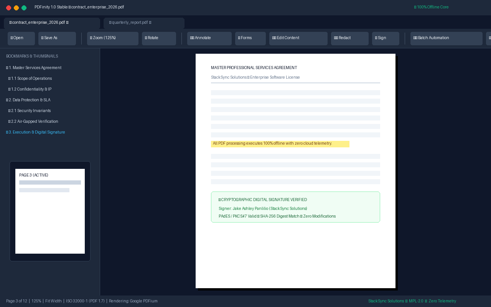
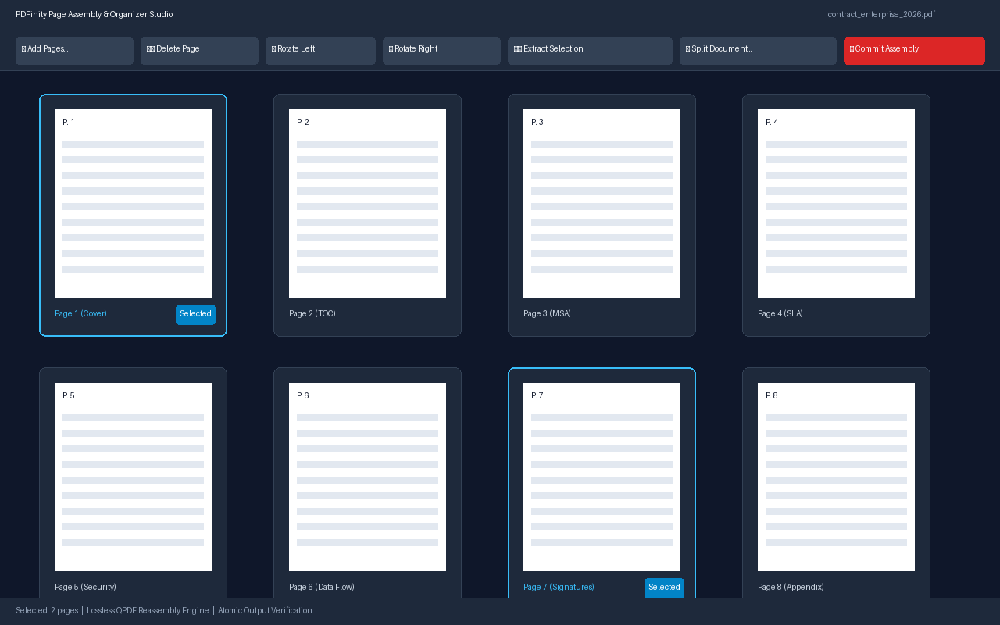
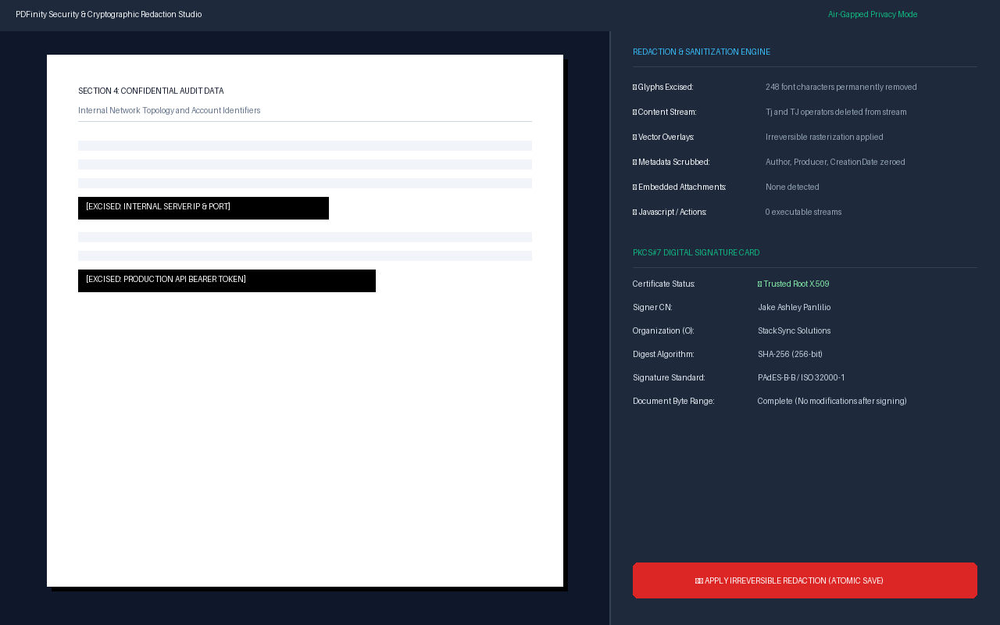
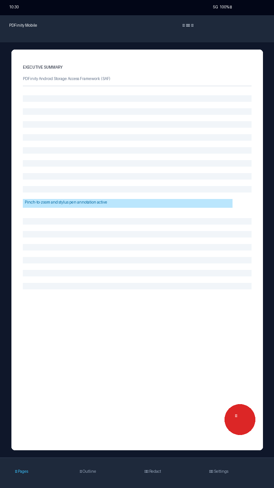

<div align="center">


# PDFinity

**Professional • Modular • Offline-First PDF Productivity Suite**

[](https://github.com/jakepanlilio2000/PDFinity/releases/tag/v1.0.12)
[](https://github.com/jakepanlilio2000/PDFinity/releases/tag/v1.0.12)
[](LICENSE)
[](https://en.wikipedia.org/wiki/C%2B%2B20)
[](https://www.qt.io/)
[](docs/PLATFORM_SUPPORT.md)
[](#security-privacy--architectural-invariants)

*Engineered by **[StackSync Solutions](https://www.stacksyncsolutions.com/)**  
Lead Programmer: **[Jake Ashley Panlilio](https://github.com/jakepanlilio2000)***

</div>

---

## Table of Contents

- [Overview](#overview)
- [Visual Showcase](#visual-showcase)
- [Core Capabilities & Feature Matrix](#core-capabilities--feature-matrix)
- [Security, Privacy & Architectural Invariants](#security-privacy--architectural-invariants)
- [Non-Developer Quickstart](#non-developer-quickstart)
  - [Windows 10 / 11](#windows-10--11)
  - [Linux Distributions](#linux-distributions)
  - [macOS (Apple Silicon & Intel)](#macos-apple-silicon--intel)
  - [Android (Phones & Tablets)](#android-phones--tablets)
- [Developer Guide & Build Instructions](#developer-guide--build-instructions)
  - [Prerequisites by Platform](#prerequisites-by-platform)
  - [CMake Presets & Build Workflow](#cmake-presets--build-workflow)
  - [Command-Line Diagnostics & Headless Smoke Tests](#command-line-diagnostics--headless-smoke-tests)
- [Documentation Index](#documentation-index)
- [Authorship & License](#authorship--license)

---

## Overview

**PDFinity** is a modern, high-performance, modular desktop and mobile PDF productivity suite built with C++20 and Qt 6. Designed from first principles for absolute document integrity, memory safety, and verifiable privacy, PDFinity operates **100% offline** with zero telemetry, zero cloud accounts, and zero background network calls.

PDFinity brings together a dual-engine architecture:
- **Google PDFium** powers instant sub-pixel page rasterization, geometry extraction, interactive AcroForm rendering, and text layout analysis.
- **QPDF** drives lossless structural page manipulation, stream encryption/decryption, linearization, cross-reference repair, and object stream transformation.

Whether you are performing high-volume document triage, restructuring large publications, filling dynamic interactive forms, applying PKCS#7 x509 cryptographic digital signatures, excising confidential data with multi-pass irreversible redaction, extracting text with local Tesseract OCR, or driving batch automation through CLI and Model Context Protocol (MCP) agents, PDFinity delivers total document autonomy.

---

## Visual Showcase

| Main Workspace (High-DPI Multi-Document View) | Page Organizer & Visual Assembly |
| :---: | :---: |
| [](docs/screenshots/main-workspace.png) | [](docs/screenshots/page-organizer.png) |
| *Tabbed document viewer with continuous scrolling, dark/light themes, and search.* | *Drag-and-drop page assembly, rotation, split, merge, and page reordering.* |

| Cryptographic Signatures & Irreversible Redaction | Android Mobile Touch Interface |
| :---: | :---: |
| [](docs/screenshots/redaction-signing.png) | [](docs/screenshots/android-view.png) |
| *PKCS#7 x509 digital signing, certificate validation, and vector stream redaction.* | *Touch-optimized mobile workflow with Storage Access Framework (SAF).* |

---

## Core Capabilities & Feature Matrix

| Capability Module | Key Features & Implementation Details | Documentation |
| :--- | :--- | :---: |
| **High-Speed Rendering** | Google PDFium rasterization, sub-pixel text antialiasing, continuous single-page and two-page spreads, smooth High-DPI scaling (up to 800%), thumbnail strip rendering. | [User Guide](docs/USER_GUIDE.md) |
| **Visual Page Organization** | Grid-based drag-and-drop reordering, 90°/180° rotation, page extraction, insertion, page deletion, multi-document merging, and lossless split. | [User Guide](docs/USER_GUIDE.md) |
| **Annotations & Markups** | Highlight, underline, squiggly, strikeout, freehand ink with pressure smoothing, rectangular and circular vector callouts, customizable sticky notes, stamp watermarks. | [User Guide](docs/USER_GUIDE.md) |
| **Interactive AcroForms** | Native rendering and interactive editing of text fields, checkboxes, radio button groups, comboboxes, push buttons, form calculation events, and one-click flattening. | [User Guide](docs/USER_GUIDE.md) |
| **Direct Content Editing** | Real-time text block editing, typographical adjustments (font size, color, baseline), vector shape insertion, and image placement with aspect-ratio preservation. | [Content Limits](docs/CONTENT_EDITING_LIMITS.md) |
| **Cryptographic Signatures** | PKCS#7 / PAdES-BES digital signatures using local PKCS#12 (`.p12` / `.pfx`) certificates, timestamping tokens, visual signature seals, and validation. | [Signatures](docs/SIGNATURES_AND_SECURITY.md) |
| **Irreversible Redaction** | Deep multi-pass redaction that strips underlying text glyphs, font character mappings, vector paths (`Tj`, `TJ`, `Do`), and raster images from PDF content streams. | [Redaction](docs/REDACTION_AND_SANITIZATION.md) |
| **Local Tesseract OCR** | Offline optical character recognition for scanned records, automatic orientation deskewing, searchable invisible text layer overlay. | [User Guide](docs/USER_GUIDE.md) |
| **Batch CLI Automation** | Headless command-line utility (`pdfinity --headless-smoke` / batch script) for bulk merging, splitting, converting, encrypting, and stamping. | [Batch Automation](docs/BATCH_AUTOMATION.md) |
| **Model Context Protocol (MCP)** | Stdio JSON-RPC MCP server integration allowing local agentic assistants to inspect, annotate, and transform documents safely. | [MCP Guide](docs/MCP_OPERATOR_GUIDE.md) |
| **Remote Companion Controller** | Sandboxed local REST / WebSocket interface bound to `127.0.0.1` protected by bearer tokens for automation and remote workflows. | [Remote Spec](docs/REMOTE_CONTROLLER_SPEC.md) |

---

## Security, Privacy & Architectural Invariants

PDFinity is engineered to adhere to strict security and privacy standards:

1. **100% Air-Gapped & Offline Guarantee:**
   - PDFinity makes **zero outbound network connections**.
   - No telemetry, no crash reporting beacons, no usage analytics, and no remote license validation.
   - All document processing, cryptographic verification, and OCR occur exclusively on your local CPU.

2. **Atomic File Operations & Zero-In-Place Modification:**
   - PDFinity **never** mutates open documents in-place.
   - Modified documents are serialized to an isolated staging file on the target filesystem.
   - Cross-reference tables (`xref`) and trailer dictionaries are structurally validated before executing an atomic filesystem rename (`MoveFileExW` / `renameat2`), preventing document corruption upon power interruption.

3. **Verifiable Redaction Integrity:**
   - Unlike superficial viewers that draw black rectangles over confidential information, PDFinity's redaction engine parses and reconstructs the underlying PDF content streams.
   - Text operators, character widths, font descriptors, and underlying image tiles are permanently removed from the object graph.

4. **Sandboxed Local IPC:**
   - The MCP stdio server and Remote Controller communicate exclusively via local process pipes or loopback sockets (`127.0.0.1`).
   - All remote commands require cryptographically secure bearer authentication tokens generated per session.

---

## Non-Developer Quickstart

### Windows 10 / 11

Choose from three official distribution packages:

- **Setup Wizard (`PDFinity-Setup-x64.exe`):**
  Download the installer from [Releases](https://github.com/jakepanlilio2000/PDFinity/releases), run the wizard, and follow the on-screen steps.
  - *Silent enterprise deployment:*
    ```cmd
    PDFinity-Setup-x64.exe /VERYSILENT /SUPPRESSMSGBOXES /NORESTART /TASKS="fileassoc"
    ```
- **Enterprise MSI (`PDFinity-x64.msi`):**
  Deploy silently via Active Directory Group Policy (GPO) or Microsoft Intune:
  ```cmd
  msiexec /i PDFinity-x64.msi /qn /norestart
  ```
- **Portable Zero-Footprint ZIP (`PDFinity-windows-x64-portable.zip`):**
  Extract the ZIP archive to any directory or removable drive and run `PDFinity.exe`. Configuration data is stored locally in `data/`, leaving the Windows Registry completely untouched.

---

### Linux Distributions

PDFinity natively packages for all major Linux distributions:

#### Debian, Ubuntu & Linux Mint (`.deb`)
```bash
sudo apt install ./pdfinity_amd64.deb
```

#### Arch Linux & Manjaro (`PKGBUILD`)
```bash
cd packaging/linux/arch
makepkg -si
```

#### Fedora, RHEL & openSUSE (`.rpm`)
```bash
# Fedora / RHEL
sudo dnf install ./pdfinity.x86_64.rpm

# openSUSE
sudo zypper install ./pdfinity.x86_64.rpm
```

#### Universal Standalone AppImage
```bash
chmod +x PDFinity-x86_64.AppImage
./PDFinity-x86_64.AppImage
```

#### Sandboxed Flatpak
```bash
flatpak-builder --user --install --force-clean build-dir packaging/linux/flatpak/com.stacksyncsolutions.pdfinity.yml
flatpak run com.stacksyncsolutions.pdfinity
```

---

### macOS (Apple Silicon & Intel)

1. Download `PDFinity.dmg` from the [Releases](https://github.com/jakepanlilio2000/PDFinity/releases) page.
2. Double-click to mount the disk image.
3. Drag **PDFinity.app** into your `/Applications` directory.
4. Launch PDFinity from Spotlight or Launchpad.

---

### Android (Phones & Tablets)

PDFinity provides full mobile document viewing, page reordering, and annotation:

- **Standalone APK (`PDFinity-release.apk`):** Download from the official [Releases](https://github.com/jakepanlilio2000/PDFinity/releases) page or F-Droid, or sideload via Android Debug Bridge (ADB):
  ```bash
  adb install -r PDFinity-release.apk
  ```
- **Android App Bundle (`PDFinity-release.aab`):** Built for Google Play Store and modern app stores. To deploy locally using `bundletool`:
  ```bash
  bundletool build-apks --bundle=PDFinity-release.aab --output=pdfinity.apks --mode=universal
  bundletool install-apks --apks=pdfinity.apks
  ```
- **Storage Access Framework (SAF):** PDFinity requests zero broad storage permissions (`MANAGE_EXTERNAL_STORAGE`), communicating exclusively through Android's secure system document picker to open and save files on internal storage, SD cards, and USB drives.

---

## Developer Guide & Build Instructions

PDFinity utilizes modern CMake with standardized presets for deterministic, reproducible builds.

### Prerequisites by Platform

| Operating System | Compiler & Toolchain | Dependencies | Package Installation |
| :--- | :--- | :--- | :--- |
| **Windows x64** | MSVC 2022 / 2026 (C++20), CMake 3.25+, Ninja | Qt 6.8+ LTS (msvc2022_64), Windows SDK | Visual Studio Installer or `vcpkg install` |
| **Ubuntu / Debian** | GCC 11+ or Clang 14+, CMake 3.25+, Ninja | Qt 6 Base, Mesa GL, xkbcommon | `sudo apt install build-essential cmake ninja-build qt6-base-dev libgl1-mesa-dev libxkbcommon-dev` |
| **Arch Linux** | GCC 11+ / Clang, CMake, Ninja | Qt 6 Base, Mesa | `sudo pacman -S base-devel cmake ninja qt6-base mesa` |
| **Fedora / RHEL** | GCC 11+ / Clang, CMake, Ninja | Qt 6 Base, Mesa GL | `sudo dnf install @development-tools cmake ninja-build qt6-qtbase-devel mesa-libGL-devel` |
| **macOS** | Xcode 15+ (Apple Clang), CMake 3.25+, Ninja | Qt 6.8+ LTS | `brew install cmake ninja qt@6` |
| **Android** | Android NDK r25b+, Android SDK API 34+ | Qt 6 for Android (arm64-v8a) | Qt Maintenance Tool -> Android component |

---

### CMake Presets & Build Workflow

#### 1. Windows x64 (MSVC 2022/2026)
Open the **Visual Studio Developer Command Shell**:
```cmd
:: Configure Release build
cmake --preset windows-x64-release

:: Compile all targets
cmake --build --preset windows-x64-release

:: Execute automated test suite
ctest --preset windows-x64-release --output-on-failure

:: Run PDFinity
.\build\windows-x64-release\bin\PDFinity.exe
```

#### 2. Linux x64 (GCC / Clang)
```bash
# Configure and build
cmake --preset linux-x64-release
cmake --build --preset linux-x64-release

# Run tests in virtual framebuffer
xvfb-run ctest --preset linux-x64-release --output-on-failure

# Launch PDFinity
./build/linux-x64-release/bin/PDFinity
```

#### 3. macOS (Apple Silicon / Intel)
```bash
cmake --preset macos-release
cmake --build --preset macos-release
ctest --preset macos-release --output-on-failure
open ./build/macos-release/bin/PDFinity.app
```

---

### Command-Line Diagnostics & Headless Smoke Tests

The PDFinity binary supports runtime diagnostic switches:

```cmd
:: Query version, lead programmer, and copyright info
PDFinity.exe --version

:: Print structured authorship and attribution details
PDFinity.exe --about

:: Execute headless smoke test and return exit code 0
PDFinity.exe --headless-smoke

:: Launch and directly load a target document
PDFinity.exe "C:\Documents\Contract.pdf"
```

---

## Documentation Index

Explore the comprehensive technical and operational documentation:

| Document | Description |
| :--- | :--- |
| **[Architecture Specification](docs/ARCHITECTURE.md)** | Subsystem breakdown, dual-engine abstraction, thread topology, and data flow. |
| **[Build & Compilation Guide](docs/BUILD.md)** | In-depth compiler setup, dependencies, and packaging steps for all platforms. |
| **[Installation & Deployment Guide](docs/INSTALLATION.md)** | Enterprise silent deployment, MSI switches, portable mode, and package managers. |
| **[Target Platform Support](docs/PLATFORM_SUPPORT.md)** | Hardware requirements, OS support matrix, and High-DPI handling. |
| **[End-User Manual](docs/USER_GUIDE.md)** | Step-by-step walkthrough of viewing, editing, annotating, signing, and printing. |
| **[Android Port & Architecture](docs/ANDROID_PORT.md)** | Storage Access Framework, Android NDK bridge, and touch interaction model. |
| **[Batch Automation CLI](docs/BATCH_AUTOMATION.md)** | Command-line parameters, headless transformations, and bulk processing scripts. |
| **[Model Context Protocol Guide](docs/MCP_OPERATOR_GUIDE.md)** | JSON-RPC stdio integration guide for local AI developer tooling. |
| **[Remote Controller Specification](docs/REMOTE_CONTROLLER_SPEC.md)** | REST / WebSocket API specification for localhost companion remote control. |
| **[Redaction & Sanitization](docs/REDACTION_AND_SANITIZATION.md)** | Technical analysis of multi-pass redaction, metadata scrub, and stream reconstruction. |
| **[Signatures & Cryptography](docs/SIGNATURES_AND_SECURITY.md)** | PKCS#7 / PAdES signing, X.509 certificate parsing, and certificate store integration. |
| **[Standards Compliance](docs/STANDARDS_COMPLIANCE.md)** | ISO 32000-1 (PDF 1.7), ISO 32000-2 (PDF 2.0), and PDF/A compliance specifications. |
| **[Supported Formats](docs/SUPPORTED_FORMATS.md)** | File formats, compression algorithms, image types, and export pipelines. |
| **[Content Editing Limits](docs/CONTENT_EDITING_LIMITS.md)** | Safe boundaries, font subsetting policies, and layout reflow behaviors. |
| **[Software Bill of Materials](docs/SBOM.md)** | Complete component inventory, licenses, and SHA-256 integrity hashes. |
| **[Security Policy](SECURITY.md)** | Vulnerability reporting procedures, threat model, and security disclosure policy. |
| **[Contributing Guidelines](CONTRIBUTING.md)** | Code style conventions, git commit standards, and pull request workflows. |
| **[Third-Party Licenses](THIRD_PARTY_LICENSES.md)** | Legal attributions and license texts for all linked open-source libraries. |
| **[Changelog](CHANGELOG.md)** | Release history, feature additions, fixes, and version progression. |

---

## Authorship & License

- **Product Name:** PDFinity
- **Organization / Publisher:** [StackSync Solutions](https://www.stacksyncsolutions.com/)
- **Lead Programmer:** [Jake Ashley Panlilio](https://github.com/jakepanlilio2000)
- **Primary License:** [Mozilla Public License Version 2.0 (MPL-2.0)](LICENSE)

```text
PDFinity — Professional Modular Offline-First PDF Productivity Suite
Copyright (c) 2026 StackSync Solutions. Lead Programmer: Jake Ashley Panlilio.
Covered Software is provided under the terms of the Mozilla Public License, v. 2.0.
```

---

<div align="center">
  <sub>Built with precision and care for sovereign, private, and local document computing.</sub>
</div>
