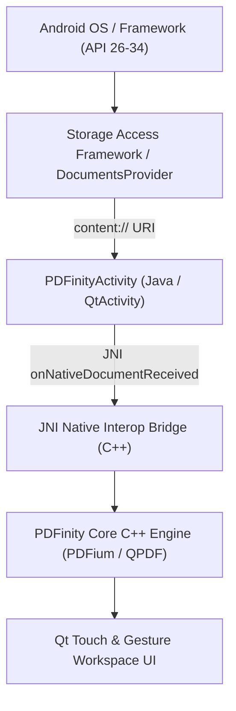

# PDFinity Android Port & Architecture Specification

**Organization / Publisher:** [StackSync Solutions](https://www.stacksyncsolutions.com/)  
**Lead Programmer:** [Jake Ashley Panlilio](https://github.com/jakepanlilio2000)  
**License:** Mozilla Public License Version 2.0 (MPL-2.0)  

---

## 1. Executive Summary

PDFinity provides native cross-platform support for Android devices running Android 8.0 (API level 26) through Android 14+ (API level 34). The Android port utilizes Qt 6 for Android combined with native C++20 PDFium and QPDF engines. By integrating directly with the Android Storage Access Framework (SAF) and Android Activity lifecycle via JNI, PDFinity provides a secure, offline-first, touch-optimized PDF reading and manipulation suite on mobile and tablet form factors.

---

## 2. System Architecture



### 2.1 Native Components
- **Native Activity (`com.stacksyncsolutions.pdfinity.PDFinityActivity`)**: Extends `org.qtproject.qt.android.bindings.QtActivity` to intercept standard Android Intents (`ACTION_VIEW`, `ACTION_EDIT`, `ACTION_SEND`), process file-provider content URIs, and delegate to the core C++ engine.
- **JNI Bridge (`src/app/AndroidJniBridge.cpp`)**: Connects Java runtime intent callbacks with the C++ document workspace and session manager.
- **Rendering Pipeline**: Powered by Google PDFium compiled for target Android ABIs (`arm64-v8a`, `armeabi-v7a`, `x86_64`), rendering into hardware-accelerated OpenGL / Vulkan surfaces via Qt's RHI (Rendering Hardware Interface).

---

## 3. Storage Access Framework (SAF) & Scoped Storage

Modern Android versions enforce Scoped Storage restrictions. Traditional direct filesystem paths (`/sdcard/document.pdf`) are deprecated or inaccessible for general document exchange.

### 3.1 Content URI Ingestion
1. When a user selects a PDF from Google Drive, Gmail, or a file manager, Android emits an `Intent` containing a `content://` URI.
2. `PDFinityActivity` intercepts the incoming URI.
3. The application opens an `InputStream` via `ContentResolver.openInputStream(uri)`.
4. The stream is streamed into an isolated application-private cache directory (`context.getCacheDir() / "saf_inbox"`).
5. The resulting temporary path is passed to PDFium for multi-threaded random-access reading and rendering.

### 3.2 Document Saving & Export
- Modified documents and new exports are committed back through SAF using `Intent.ACTION_CREATE_DOCUMENT` (`application/pdf`).
- This guarantees compliance with Android 11+ storage mandates without requesting elevated broad-storage permissions.

---

## 4. Mobile & Touch UI Adaptations

The PDFinity mobile interface adapts the desktop Qt Widgets layout for touch interaction:
- **Pinch-to-Zoom**: Two-point multi-touch gestures scale the active document viewport dynamically with bilinear filtering.
- **Continuous Touch Scrolling**: Momentum-based inertial scrolling with physics simulation for fluid navigation.
- **Touch-Friendly Hit Targets**: Minimum 48dp hit targets for annotation tools, bookmark toggles, and form field interactions.
- **Stylus & S-Pen Support**: Distinguishes stylus pen inputs from touch gestures, allowing palm rejection while annotating, signing, or drawing on PDF pages.

---

## 5. Build & Packaging Instructions

### 5.1 Prerequisites
- **Java Development Kit (JDK)**: JDK 17 or higher
- **Android SDK**: API Level 34 with SDK Build-Tools 34.0.0
- **Android NDK**: NDK r25c or higher
- **Qt 6 for Android**: Qt 6.5.0+ configured for Android ABIs (`arm64-v8a`)
- **CMake**: 3.25+
- **Ninja**: 1.11+

### 5.2 Environment Variables
Ensure the following environment variables are exported:
```bash
export JAVA_HOME=/path/to/jdk-17
export ANDROID_SDK_ROOT=/path/to/android-sdk
export ANDROID_NDK_ROOT=${ANDROID_SDK_ROOT}/ndk/25.2.9519653
export Qt6_DIR=/path/to/Qt/6.8.2/android_arm64_v8a/lib/cmake/Qt6
```

### 5.3 Building with Gradle
To compile and assemble the Android APK package:
```bash
cd android
./gradlew assembleRelease
```
The output APK is generated at:
`android/build/outputs/apk/release/PDFinity-release-unsigned.apk`

### 5.4 Automated Script
Alternatively, run the packaging script:
```bash
bash packaging/android/build_apk.sh Release
```

---

## 6. Security & Permissions

PDFinity adheres strictly to least-privilege principles on Android:
- **No Unnecessary Telemetry**: PDFinity contains zero analytics, tracking SDKs, or background telemetry services.
- **Local Loopback Only**: The `INTERNET` permission is restricted to local socket loopback (`127.0.0.1`) when running optional Model Context Protocol (MCP) servers or the paired Remote Controller companion interface.
- **Sandboxed Execution**: Documents are isolated within private internal cache directories and deleted upon application session termination.
