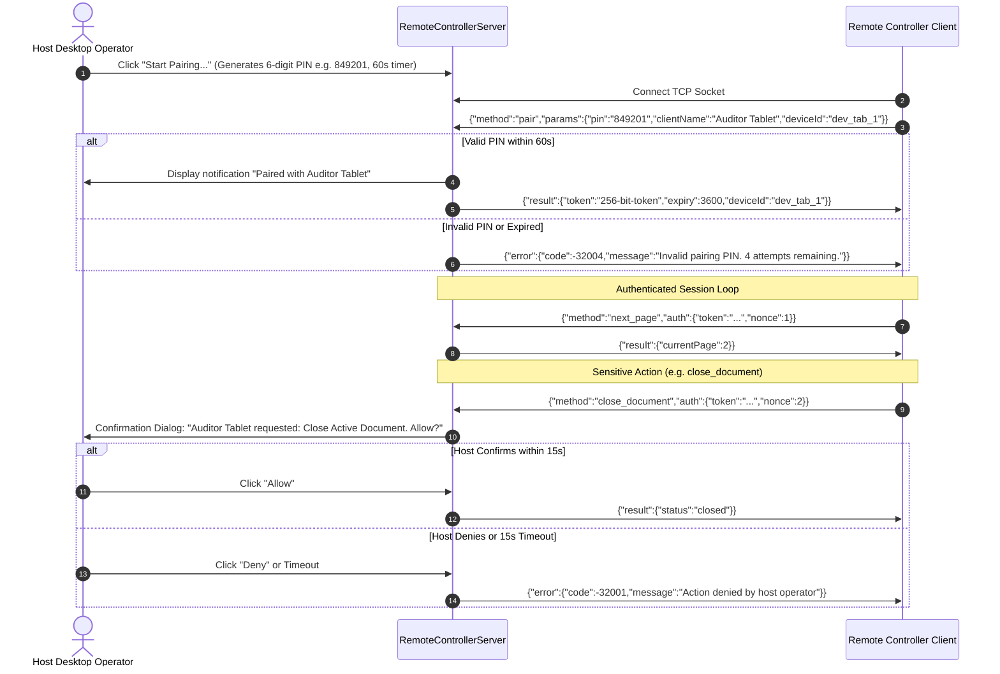

# PDFinity: Remote Controller Protocol, Threat Model & Architecture Specification

**Publisher:** StackSync Solutions ([stacksyncsolutions.com](https://www.stacksyncsolutions.com/))  
**Lead Programmer:** Jake Ashley Panlilio ([github.com/jakepanlilio2000](https://github.com/jakepanlilio2000))  
**Primary License:** Mozilla Public License Version 2.0 (MPL-2.0)  
**Status:** Official Remote Controller Specification  

---

## 1. Executive Summary & Philosophy

The PDFinity Remote Controller provides an optional, authenticated companion interface allowing trusted local devices (e.g., tablet presentation remotes, secondary monitors, or automated workflow runners) to control active PDF viewing, page navigation, search, and job monitoring over a local TCP network socket.

### Core Architectural Invariants
1. **Strictly Opt-In & Disabled by Default:** The network service is inactive on initial startup. No port is bound and zero sockets listen until explicitly started by the user in settings.
2. **Local Interface Isolation:** The service binds strictly to `127.0.0.1` (loopback) or a user-selected private LAN interface (e.g. `192.168.x.x`). Binds to `0.0.0.0` (wildcard) are prohibited without explicit multi-homed confirmation. No UPnP, NAT-PMP, or public internet exposure is permitted.
3. **Cryptographic Pairing & Mutual Authentication:** Client devices must pair with the host using a short-lived 6-digit cryptographic one-time PIN (60-second expiry) with brute-force rate-limiting (5 failures -> 5-minute lockout). Successful pairing generates a 256-bit cryptographically random bearer token.
4. **Command Allowlist (Zero Shell Execution):** The protocol exposes only narrow, domain-specific PDF operations. No remote shell, arbitrary file execution, or script evaluation exists.
5. **Mandatory Host Confirmation for Sensitive Actions:** Destructive or state-altering commands (closing unsaved documents, triggering batch conversion profiles) require an interactive confirmation dialog on the host desktop. If the operator denies or fails to respond within 15 seconds, the action is rejected.
6. **Visible State Indicator & Immediate Revocation:** A persistent status indicator is visible in the desktop shell while any device is connected. The host can instantly disconnect all sessions or revoke individual paired devices at any moment.

---

## 2. Threat Model (STRIDE)

| Threat Category (STRIDE) | Attack Vector / Scenario | Architectural Mitigation | Residual Risk |
| :--- | :--- | :--- | :---: |
| **Spoofing (S)** | An unauthorized device on the local Wi-Fi/LAN attempts to connect and control PDF presentations or view private documents. | 1. Disabled by default.<br>2. Short-lived 6-digit numeric PIN (60s lifetime).<br>3. 256-bit cryptographic session token issued only upon valid PIN presentation.<br>4. Replay protection via monotonically increasing request nonce and timestamp validity check (±30s window). | **Zero** |
| **Tampering (T)** | Attacker intercepts or modifies unencrypted in-flight control packets over local LAN. | Token-based message integrity checking with request nonces. Paired sessions validate token, nonce, and client device ID on every frame with optional TLS 1.3 encryption wrapper. | **Very Low** |
| **Repudiation (R)** | Operator or remote user denies issuing remote document commands or starting batch tasks. | Append-only audit logger records timestamp, client device ID, IP address, command name, outcome status (`ALLOWED`, `CONFIRMED`, `DENIED`, `RATE_LIMITED`), and diagnostic details. | **Zero** |
| **Information Disclosure (I)** | Rogue client retrieves document contents or secret cryptographic signing keys. | 1. No signing keys or passwords are ever exposed via Remote Controller.<br>2. Only currently mounted document metadata, rendered page thumbnails, and search matches are accessible.<br>3. Path traversal outside approved roots is blocked. | **Zero** |
| **Denial of Service (D)** | Attacker floods the open TCP port with rapid pairing attempts or huge payloads. | 1. Rate-limiting: 5 invalid pairing attempts triggers a 300-second lockout.<br>2. Per-connection rate limit: maximum 25 requests per second per client.<br>3. Payload limit: 2 MB maximum frame size. Larger frames close the socket. | **Low** |
| **Elevation of Privilege (E)** | Remote client attempts to execute arbitrary shell commands or overwrite local system files. | **Strict Allowlist:** Commands are mapped directly to a fixed C++ `enum class RemoteCommand`. Any unlisted command name returns `404 Command Not Found`. No shell execution exists. | **Zero** |

---

## 3. Protocol Specification

### Wire Format
- **Transport:** Line-delimited JSON-RPC 2.0 over TCP (standard UTF-8 strings ending with `\n`).
- **Framing:** Each message is a complete JSON object serialized on a single line.
- **Port:** Default `8443` (configurable between `1024` and `65535`).

### Message Framing Structure

#### Client Request Frame
```json
{
  "jsonrpc": "2.0",
  "id": 101,
  "method": "goto_page",
  "params": {
    "page": 5
  },
  "auth": {
    "deviceId": "dev_ipad_9a4f21",
    "token": "a8f3b20c19e48d7123456789abcdef0123456789abcdef0123456789abcdef01",
    "nonce": 42,
    "timestamp": 1731580800
  }
}
```

#### Host Response Frame
```json
{
  "jsonrpc": "2.0",
  "id": 101,
  "result": {
    "status": "success",
    "currentPage": 5,
    "pageCount": 42
  }
}
```

#### Host Error Frame
```json
{
  "jsonrpc": "2.0",
  "id": 101,
  "error": {
    "code": -32001,
    "message": "Action requires operator confirmation on host desktop; request was rejected or timed out"
  }
}
```

---

## 4. Pairing & Authentication Lifecycle



---

## 5. Command Allowlist & Permission Matrix

| Command | Category | Host Confirmation Required? | Parameters | Description |
| :--- | :---: | :---: | :--- | :--- |
| `status` | ReadOnly | No | None | Returns active document title, page count, current page, zoom level, and layout mode. |
| `goto_page` | Navigation | No | `{"page": integer}` (1-based) | Navigates viewport to designated page index. |
| `next_page` | Navigation | No | None | Advances viewport to next page. |
| `prev_page` | Navigation | No | None | Steps viewport to previous page. |
| `first_page` | Navigation | No | None | Jumps to page 1. |
| `last_page` | Navigation | No | None | Jumps to final document page. |
| `set_zoom` | Viewport | No | `{"level": number}` or `{"mode": "fit_width" \| "fit_page"}` | Adjusts zoom magnification percentage or auto-fit mode. |
| `search` | Search | No | `{"query": string, "matchCase": bool}` | Searches active document and jumps to first/next match. |
| `thumbnail` | ReadOnly | No | `{"page": integer, "width": integer}` | Renders base64 PNG thumbnail of the requested page. |
| `job_status` | Batch/Jobs | No | None | Queries status of active batch processing jobs and progress percentage. |
| `job_pause` | Batch/Jobs | No | `{"jobId": string}` | Pauses an active batch job. |
| `job_resume` | Batch/Jobs | No | `{"jobId": string}` | Resumes a paused batch job. |
| `job_cancel` | Batch/Jobs | **Yes** | `{"jobId": string}` | Cancels an active batch job (requires host confirmation). |
| `toggle_fullscreen` | Presentation | No | None | Toggles distraction-free full-screen presentation mode. |
| `close_document` | Sensitive | **Yes** | None | Closes active document (requires host operator approval before closing). |
| `batch_start` | Sensitive | **Yes** | `{"profileId": string, "inputDir": string, "outputDir": string}` | Initiates a batch workflow (strictly requires host modal confirmation). |
| `disconnect` | Session | No | None | Closes client session cleanly and invalidates active session token. |

Any command outside this table returns JSON-RPC error `-32601 Method Not Found`.

---

## 6. Host Desktop Security Controls

1. **Persistent Visual Connection Indicator:**
   - When a remote device connects, the main window status bar renders a distinct green pill:
     `[Remote: Connected (Auditor Tablet - 192.168.1.45)] [Disconnect]`
   - Clicking `[Disconnect]` immediately tears down the TCP socket and invalidates the session token.
2. **Emergency Disable Button:**
   - Instantly unbinds the TCP listener, closes all active sockets, clears active tokens, and sets `remoteEnabled = false`.
3. **Paired Device Manager:**
   - Displays all paired devices with device ID, friendly name, pairing timestamp, and last seen IP.
   - Operators can selectively revoke any paired device, permanently blocking reconnection.
4. **Audit Log Table:**
   - In-memory ring buffer tracking up to 1,000 remote events with timestamps, client names, IPs, commands, and approval outcomes.
